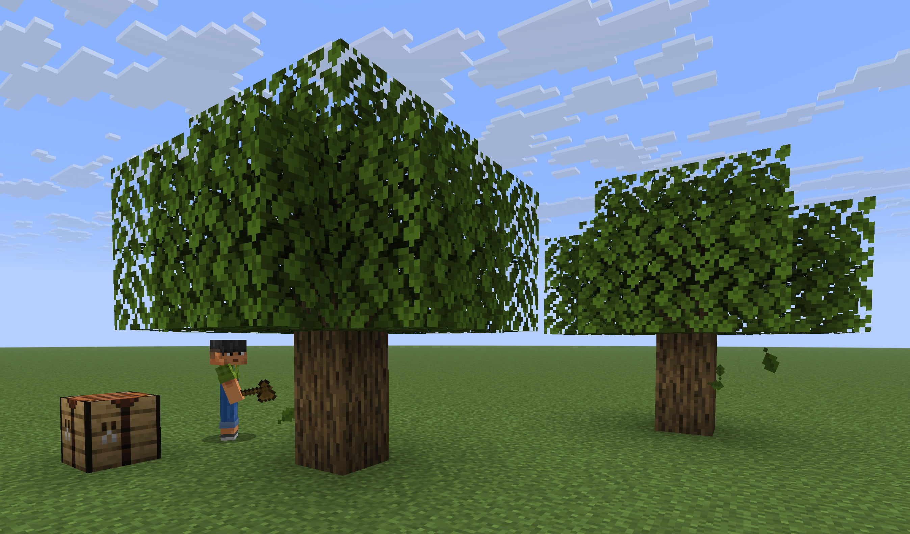

# MinecraftLLM

A personal R&D project exploring what local language models can do inside Minecraft. Give the bot a request in chat, then inspect how it plans, calls tools and checks the result against the game state.

I developed this TypeScript prototype with Codex and Cursor. Mineflayer controls the character; local models make decisions through an OpenAI-compatible API. The project includes a multi-agent workflow, a world controller, an Architect workbench and repeatable in-game tests.



[Read the development story](https://grapixlegrand.github.io/pages/minecraft-agent/) · [Architecture](docs/architecture.md) · [Tool contracts](docs/tools.md) · [Test scenarios](docs/scenario-testing.md)

## What is here

- **Coordinator:** talks to the player, delegates work and reviews step completion.
- **Planner:** consults recipe cards and creates a checklist with success criteria. Supported inventory conditions can be evaluated by code.
- **Action agent:** executes one delegated step through observations and physical tools. Collection and building run algorithmically behind a single tool call.
- **Architect:** draws a shelter as horizontal ASCII layers, receives validation feedback and returns a saved Blueprint with its material requirements.
- **Inspector:** shows the actual prompts, tool schemas, responses, errors and execution traces.
- **World controller and test runner:** prepare controlled environments and verify outcomes independently of the model's claims.

Calls run sequentially: the agent decides, executes a tool, observes the result, then decides again. Each subagent starts a fresh conversation when delegated work. The coordinator retains its conversation during the process lifetime.

This is an experimental prototype. Models can still misplan, retry unhelpfully or reach a timeout. A valid tool call or Blueprint does not by itself prove the player's objective was met.

## Quick start

The commands below use Windows PowerShell. On macOS/Linux, use `npm` instead of `npm.cmd` and adapt paths and environment-variable syntax.

### 1. Install the project

Prerequisites:

- **Node.js 22 or newer** and npm.
- A **Minecraft Java server** matching `MINECRAFT_VERSION` in [src/config.ts](src/config.ts), currently `1.21.11`, plus a compatible Java runtime.
- A local **OpenAI-compatible Chat Completions server** with tool-calling support. The current configuration targets llama-swap/llama.cpp; Ollama is also configured.
- A Minecraft client to join the server and send requests in chat.

```powershell
git clone https://github.com/MagicGrapix/MinecraftLLM.git
cd MinecraftLLM
npm.cmd ci
```

The project does not download or start Minecraft or the LLM server for you. Model weights, server files and saved worlds are not included.

### 2. Prepare Minecraft

Use a disposable local test world. The bot currently connects with offline authentication. For this local setup, configure `online-mode=false` in `server.properties` and bind the server to `127.0.0.1`; do not expose an offline-authentication server publicly.

The world controller and campaigns assume a superflat overworld with bedrock at Y=-64, two dirt layers at -63/-62, grass at -61 and air above. Their default editable arena is X/Z=-48..48, Y=-64..-30. Back up any world you care about before using them.

If you keep your matching server JAR at `server/server.jar`, start it in a separate terminal:

```powershell
cd server
java -Xms1G -Xmx4G -jar server.jar nogui
```

On the first run, review and accept Minecraft's EULA yourself, then start the server again. Keep its console open. This example assumes you have already configured the flat world; starting an unconfigured JAR will not create the test setup automatically.

### 3. Connect your local model

The shared settings are in [src/agent/AgentConfig.ts](src/agent/AgentConfig.ts):

- `LLM_BACKEND = "llamacpp"`: `http://127.0.0.1:8080/v1`, model alias `qwen-27b`.
- `LLM_BACKEND = "ollama"`: `http://localhost:11434/v1`, model `qwen3.5:9b`.

Start your configured backend separately. For llama-swap, the alias must match an ID returned by `/v1/models`. These are project defaults, not models installed by this repository.

To override the connection for one PowerShell terminal:

```powershell
$env:LLM_BASE_URL = "http://127.0.0.1:8080/v1"
$env:LLM_API_KEY = "local"
$env:LLM_MODEL = "qwen-27b"
```

The bot and Architect workbench share these settings. [.env.example](.env.example) documents the accepted variables, but **the application does not load `.env` automatically**. Variables already set in your terminal override the code defaults.

### 4. Start the bot

From the project root, with both servers running:

```powershell
npm.cmd run dev
```

The bot joins as `bot` at `localhost:25565`. Connection overrides are `MINECRAFT_HOST`, `MINECRAFT_PORT`, `MINECRAFT_VERSION` and `MINECRAFT_USERNAME`.

Open the **[bot inspector](http://127.0.0.1:3001/)**, join Minecraft and write a request in chat, for example: `Collect four oak logs.` Make sure the required resources are nearby.

While the bot is working, ordinary new messages are ignored. Send `stop` to interrupt, or `resume` to continue. `Ctrl+C` in the terminal shuts down the bot. The playing bot does **not** need OP permissions.

For a compiled launch, run `npm.cmd run build`, then `npm.cmd start`. Restart the bot after editing its code or production prompts.

## Prepare a test world

The World Controller is a separate Mineflayer process with administrator permissions. It can reset terrain or spawn resources; the playing agent cannot call its commands.

In the **Minecraft server console**, grant only the controller OP:

```text
op world_controller
```

Then, in a second terminal at the project root:

```powershell
npm.cmd run dev:world
```

Type these commands into the **controller terminal**, not Minecraft chat:

```text
status
preview forest 10 25
forest 10 25
tree
ore iron 8
ore coal 12
```

Trees and ore generation use the connected bot's position. `forest 10 25` requests ten trees within a radius of 25 blocks. Arena bounds and limits are checked before execution. The default command throttle is two commands per second.

Destructive commands are explicit:

- `inventory clear all` permanently deletes the connected bot's items rather than dropping them.
- `clear` clears the arena above the configured surface.
- `reset` restores the flat arena, removes non-player entities inside it and resets the bot's inventory and position. Time and weather settings also affect the world.

Use these only in the test world. See [controller contracts and limits](docs/contracts.md) for the exact reset behavior and configuration.

For static article scenes, use `scene list`, `preview scene 1`, then `scene 1` through `scene 4`. Disconnect the usual bot first: these scenes connect a non-LLM actor named `bot` and reset that account's position, inventory and game mode. The cover image comes from scene 1. [Scene setup and camera positions](docs/photo-scenes.md).

## Test the Architect without Minecraft

```powershell
npm.cmd run dev:architect
```

Open the **[Architect workbench](http://127.0.0.1:3004/)**. It uses the real Architect prompt, model connection and validator, but never connects to Minecraft. The model runs when you launch a trial in the page. Prompts are reloaded for each trial.

Inspect the messages, tool inputs, rejected drawings and accepted layers. The workbench supports whole-drawing and experimental layer-by-layer generation. The Minecraft workflow currently uses whole drawings: `A` means oak planks, `.` means air, and blank lines separate layers. The Architect does not build or collect materials itself.

See [the workbench guide](docs/architect-workbench.md) and [Blueprint / Builder contracts](docs/blueprints.md).

## Tests and experiments

### Offline checks: no Minecraft or LLM

```powershell
npm.cmd test
npm.cmd run test:scenarios -- --list
```

`npm test` builds the project, type-checks tests and scripts, then runs unit tests with fake bots and model clients. Listing scenarios also stays offline.

### In-game campaigns: real Minecraft and usually a real LLM

Stop the regular bot and any manual world controller before running a campaign. The runner owns `test_bot` and `test_controller`; do not launch those accounts yourself. Grant the controller OP once in the server console:

```text
op test_controller
```

Then choose a scenario from the project root:

```powershell
npm.cmd run test:scenarios -- --scenario craft_table --repeat 1
npm.cmd run test:scenarios -- --scenario craft_two_wooden_tools --repeat 1
npm.cmd run test:scenarios -- --scenario collect_four_logs --timeout 300 --repeat 1
npm.cmd run test:scenarios -- --scenario craft_iron_pickaxe_from_world --repeat 1
```

`--timeout` is in seconds. The iron-pickaxe scenario has a ten-minute limit by default. `npm.cmd run test:scenarios` runs all scenarios once; `--repeat 5` repeats each five times.

**Campaigns replace the configured arena and reset the test player's inventory between trials.** Each trial gets a fresh bot process. A failed task normally allows the campaign to continue; unsafe cleanup, infrastructure failure or source changes can stop it. Do not edit the code or interfere with the arena during a run.

Open `logs/scenarios/campaign_<timestamp>_<id>/report.html` directly in a browser. It contains per-trial verdicts, prompts, tool calls, a timeline and call counts. Criteria use observed inventory and world state, not the agent's final answer. `build_small_shelter` is a physical Builder test without an LLM; the conversational scenarios use the configured model.

The [scenario guide](docs/scenario-testing.md) lists the current fixtures, success criteria, cleanup guarantees and report files.

### Focused smoke tests

- `npm.cmd run smoke:ollama`: contacts the selected LLM backend, despite the historical script name.
- `npm.cmd run smoke:planner` and `npm.cmd run smoke:architect`: real LLM, no Minecraft connection.
- `npm.cmd run smoke:collect`: physical collection with dedicated bots, no LLM. `-- --llm` additionally tests the conversational collection/building workflow.
- `npm.cmd run smoke:build` and `npm.cmd run smoke:build-workflow`: physical building tests; the workflow test uses scripted model responses.
- `npm.cmd run check:ollama`: reads the loaded model's context length through Ollama's own API; it does not apply to llama-swap.

Physical smoke tests modify their documented test areas. Read [their prerequisites](docs/scenario-testing.md#vérifier-et-étendre) before running them.

## Configuration and code map

- [src/agent/AgentConfig.ts](src/agent/AgentConfig.ts): backend, model, output limit, request timeout and inspector settings. The default output limit is 4,096 tokens.
- [src/config.ts](src/config.ts): behavior limits and context compression. Input is estimated at three characters per token, with a 20,000-token threshold and 10,000-token target. This does not resize the model server's context window.
- [src/bootstrap/createAgentRuntime.ts](src/bootstrap/createAgentRuntime.ts): assembly of the agents, registries, execution layer and inspector.
- [src/capabilities/](src/capabilities/): physical operations, including `collect_resource`, the two crafting tools, chest/furnace operations and `build`.
- [src/world/](src/world/): observations, block access, voxel views and name lookup.
- [src/devworld/WorldBuilderConfig.ts](src/devworld/WorldBuilderConfig.ts): controller connection, arena bounds and command limits.
- [prompts/](prompts/): production agent instructions. Test prompts live separately in [tests/fixtures/prompts/](tests/fixtures/prompts/).
- [recipes/](recipes/): editable recipe cards, checked against the Minecraft registry. Restart the process after editing them.
- [experiments/](experiments/README.md): separate Python/Jupyter experiments. They are not required to run the bot.

For design details, start with [architecture](docs/architecture.md), [agent/context flow](docs/agent-workflow.md), [tool descriptions](docs/tools.md), [recipes and step checks](docs/recipes.md), and [debugging](docs/debugging.md). Some internal documentation is in French.

## Logs, local data and Git

The inspector is available only while the bot process runs. Persistent traces live in `logs/`, including `log_<session>.log` and `trace_<session>.jsonl`. They can contain chat text, prompts, model responses and local paths; review them before sharing.

Git excludes server worlds, logs, generated Blueprints, landmarks, Python environments, caches, notebook checkpoints and executed experiment copies. Source notebooks, recipe cards, test fixtures and `package-lock.json` belong in version control. Keep credentials out of tracked files; `.env.example` contains examples only.

Before switching branches, inspect `git status`. Ignoring a path does not untrack a file already committed, and an older branch can have different ignore rules. Preserve local work before switching; do not use `git clean -fdx` to tidy this repository, as it can delete worlds, logs and downloaded models.
